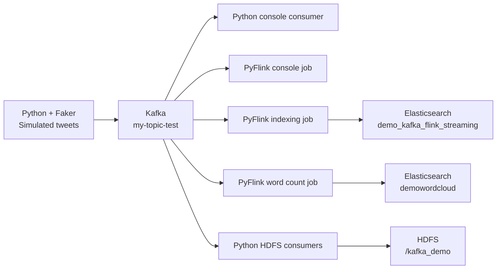

# Kafka & Flink Streaming Pipeline

I built this project to practice an end-to-end streaming pipeline with Apache Kafka and Apache Flink. The original idea was to collect tweets from the Twitter (X) API, process them as they arrive, and store the results in Elasticsearch and HDFS.

For this version, I used Python and Faker to generate a continuous stream of fake tweets instead of connecting to the X API. This lets me work on the pipeline without needing API access. **All tweets in this project are synthetic; the current code does not call the Twitter/X API.**

## How it works



The HDFS consumers read directly from Kafka. They are separate from the Flink jobs, so I can run each part independently.

## Project structure

```text
.
├── kafka_clients/
│   ├── kafka_tweets_producer.py              # Generates fake tweets and sends them to Kafka
│   ├── Kafka_tweets_consumer.py              # Displays incoming tweets in the terminal
│   ├── hdfs_consumer.py                      # Writes tweets to one HDFS JSONL file
│   └── hdfs_consumer_batch.py                # Writes batches of 50 tweets to HDFS
├── flink_jobs/
│   ├── kafka_flink_streaming.py              # Reads Kafka records with the Flink Table API
│   ├── kafka_flink_elasticsearch_streaming.py # Sends records to Elasticsearch
│   └── pyflink_word_count.py                 # Cleans text and counts words
├── .gitignore
└── README.md
```

## Simulated data

The producer sends approximately **two tweets per second**. It randomly chooses topics such as music, tech, sport, school, and news, and adds hashtags, locations, and engagement counts.

Example record (illustrative):

```json
{
  "id_str": "17600000000001234",
  "username": "Alex Example",
  "tweet": "Learning about streaming data today. #kafka #flink",
  "location": "Casablanca, MA",
  "created_at": "2026-01-10T12:00:00+00:00",
  "retweet_count": 42,
  "favorite_count": 120,
  "followers_count": 3500,
  "lang": "en",
  "hashtags": ["kafka", "flink"],
  "query": "tech"
}
```

The language label is selected randomly; it does not guarantee that the generated sentence is in that language. The Flink source schemas currently read only `id_str`, `username`, `tweet`, `location`, `retweet_count`, `followers_count`, and `lang`.

## Setup

I run the pipeline with locally available Kafka, Flink, Elasticsearch, and Hadoop services. Service installation and startup scripts are not included in this repository. The commands below assume a Linux environment or VM, especially for the HDFS consumers.

### 1. Prepare Python

```bash
python3 -m venv .venv
source .venv/bin/activate
python -m pip install kafka-python Faker rich
```

For the Flink jobs, install `apache-flink` matching your Flink runtime. The word count job also needs `nltk` and its English stopwords:

```bash
python -m pip install nltk
python -m nltk.downloader stopwords
```

The HDFS consumers additionally need `pydoop` configured for your Hadoop environment. These optional dependencies are only needed for the corresponding jobs. This repository does not include a pinned dependency environment.

### 2. Check service addresses and connector paths

The scripts currently use these values directly in the code:

| Setting | Current value |
| --- | --- |
| Kafka bootstrap server | `localhost:9092` |
| Kafka topic | `my-topic-test` |
| Elasticsearch | `http://localhost:9200` |
| HDFS directory | `hdfs://localhost:9000/kafka_demo` |
| Producer rate | `TWEETS_PER_SECOND = 2` |
| HDFS batch size | `BATCH_SIZE = 50` |

Update these values if your services run elsewhere. When running inside a VM or container, `localhost` refers to that environment.

I originally ran this project on my own machine. To run it on another computer, you need to install and configure the services above, provide the connector JARs, and adjust the service addresses if needed. Installing the Python packages alone is not enough.

The Flink jobs look for connector JARs in a `connectors/` folder at the repository root by default:

```text
connectors/
??? flink-sql-connector-kafka_2.11-1.14.4.jar
??? flink-sql-connector-elasticsearch7_2.11-1.14.4.jar
```

Create this folder and place your connector JARs there, or set `FLINK_LIB_DIR` to an existing directory containing them. For example, if they are already in your Flink installation:

```bash
export FLINK_LIB_DIR="$FLINK_HOME/lib"
```

Alternatively, use your own directory:

```bash
export FLINK_LIB_DIR="/path/to/flink/lib"
```

Set this variable in each terminal where you launch a Flink job. The scripts build the file URIs automatically, so there is no personal machine path to edit in the source code.

The console job only needs the Kafka connector; the Elasticsearch jobs need both connectors. The expected filenames reference Flink 1.14.4 and the Elasticsearch 7 connector. Check compatibility with your installed runtime; if your compatible JARs have different filenames, update the filenames in the jobs too. Connector JARs are not included in this repository.

### 3. Create the Kafka topic

With Kafka running, execute this from your Kafka installation directory:

```bash
bin/kafka-topics.sh --create --if-not-exists \
  --bootstrap-server localhost:9092 \
  --topic my-topic-test \
  --partitions 1 \
  --replication-factor 1
```

### 4. Start a consumer or Flink job

Run the following commands from the repository root, in separate terminals as needed.

To inspect tweets with Python:

```bash
python kafka_clients/Kafka_tweets_consumer.py
```

To read tweets with Flink:

```bash
python flink_jobs/kafka_flink_streaming.py
```

To write tweets to Elasticsearch:

```bash
python flink_jobs/kafka_flink_elasticsearch_streaming.py
```

To compute word counts and send them to the `demowordcloud` index:

```bash
python flink_jobs/pyflink_word_count.py
```

The Flink jobs currently share the Kafka group ID `test_3`. Run one Flink example at a time, or assign each job a different `properties.group.id` to let them consume independently.

### 5. Start the simulated stream

In another terminal:

```bash
python kafka_clients/kafka_tweets_producer.py
```

Most consumers use the latest offset, so start the consumer/job before the producer to see new records. Stop the producer with `Ctrl+C`.

### 6. Optional: store records in HDFS

With Hadoop running and Pydoop configured, choose one of these consumers:

```bash
# Write records to /kafka_demo/tweets_data.jsonl
python kafka_clients/hdfs_consumer.py

# Or write separate JSONL files in batches of 50 records
python kafka_clients/hdfs_consumer_batch.py
```

Inspect the output from your Hadoop environment:

```bash
hdfs dfs -ls /kafka_demo
hdfs dfs -cat '/kafka_demo/tweets_*.jsonl'
```

The single-file consumer starts at the earliest available offset without a consumer group, so restarting it can append the same records again. Both HDFS examples use automatic offset commits, and the batch consumer only writes full batches; a partial batch is not saved when it stops. I treat these scripts as learning examples, without an exactly-once delivery guarantee.

## Word count processing

The word count job cleans tweet text, splits it into words, removes punctuation and English stopwords, and computes running totals. It does not use time windows.

This job is still experimental: the cleaning code includes legacy handling for escaped text and slices the input with `review[2:-1]`, which can truncate normal strings from the current producer. Its Elasticsearch sink also has no primary key declared for updating running counts. These parts need review before relying on the word count output.

## What I learned

- Producing and consuming JSON events with Kafka.
- Reading a continuous Kafka stream with the PyFlink Table API.
- Connecting streaming jobs to Elasticsearch.
- Saving raw events in HDFS as JSON Lines.
- Working with text cleaning and streaming aggregations.

## Next steps

I would like to add a real X API producer while keeping the same event structure, move configuration out of the scripts, improve the word count job, and add checkpointing and safer HDFS offset handling. A reproducible environment and a dashboard for exploring the results would also make the project easier to run and demonstrate.

No X API credentials are needed for the simulated stream. Local secrets and credentials should stay outside version control.
# end-to-end-kafka-flink-streaming

